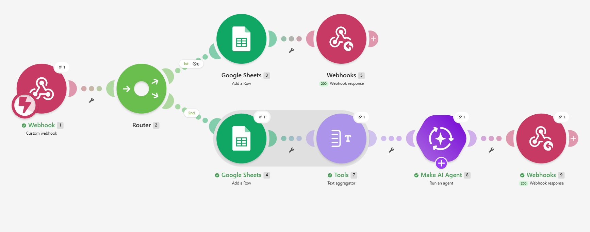

# Nombre del proyecto
¿Compras local o global?

## Descripción
Encuesta anónima sobre hábitos de compra para Desarrollo Sustentable, Unidad 4, del Instituto Tecnológico de Mazatlán. El formulario registra seis respuestas sobre comida, ropa, apps internacionales, criterio de compra, conocimiento del origen y rango de edad.

La página permite enviar una respuesta o solicitar un reporte en texto. El escenario de Make está diseñado para separar ambas acciones, registrar respuestas en Google Sheets y generar un análisis con un agente de IA.

## Objetivos de aprendizaje
- Identificar hábitos de compra en comercios locales y plataformas internacionales.
- Relacionar estas decisiones con el empleo local y el impacto del transporte y el empaque.
- Integrar un formulario web con Make, Google Sheets y un agente de IA.
- Verificar los totales y porcentajes de la IA contra los datos de Sheets.

## Material utilizado
- Computadora o celular con navegador y conexión a internet.
- HTML, CSS y JavaScript en un solo archivo, sin bibliotecas externas.
- Make con Webhook, Router, Google Sheets, Text aggregator, Make AI Agent y Webhook response.
- Google Sheets para almacenar las respuestas y GitHub para documentar el proyecto.

## Diagrama del flujo
El formulario envía por POST `accion=respuesta` con los seis campos, o solo `accion=reporte`. El Router debe separar ambas solicitudes. El diseño prevé guardar una fila al recibir una respuesta y leer las filas existentes al generar el reporte.

Formulario → Webhook → Router → Registro en Google Sheets o análisis con IA → Respuesta en la página.

## Código
- [Encuesta web](c%C3%B3digo/index.html)
- [Blueprint del escenario de Make](c%C3%B3digo/LocalOGlobal.blueprint.json)

Para utilizar el proyecto:

1. Descarga el HTML e importa el blueprint en Make. Vincula tu webhook, tu hoja de cálculo y tus conexiones de Google Sheets e IA.
2. Corrige el filtro de registro para que reciba `respuesta` y agrega un filtro `reporte` a la segunda ruta. Usa un módulo de lectura en esa ruta y pasa el texto de las filas agregadas al agente. Quita el prefijo `ro` del mapeo de ropa antes de registrar nuevos datos.
3. Activa el escenario y configura `WEBHOOK_URL` en tu copia privada del HTML.
4. Abre la encuesta, responde las seis preguntas y selecciona **Enviar respuesta**. Usa **Generar reporte** para pedir el análisis. Pulsar el título carga respuestas de ejemplo.

El blueprint publicado conserva la lógica exportada y se desvinculó de la hoja de cálculo y las conexiones originales. El reporte técnico documenta los ajustes pendientes para usarlo.

## Video del funcionamiento
[Ver demostración sin audio](video/Local_Global_sin_audio.mp4)

## Imágenes
Captura del flujo de la encuesta en Make:

## Conclusiones
La demostración muestra una sola respuesta, con compra de comida en mercado o tianguis, ropa de negocio local y uso mensual de apps internacionales. Este caso permite verificar qué significan los porcentajes que muestra la IA.

Para identificar tendencias de la comunidad se necesitan más respuestas y validar sus totales y categorías en Sheets.

## Resultados

[Reporte técnico y respuestas a las cinco preguntas (PDF)](resultados/Reporte_tecnico_local_global.pdf)
